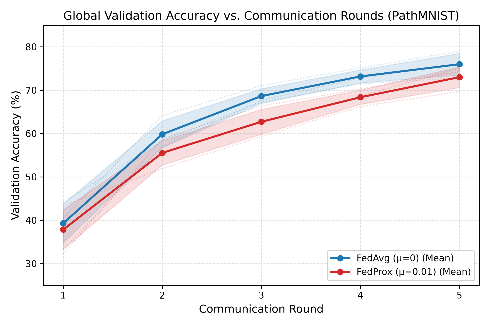
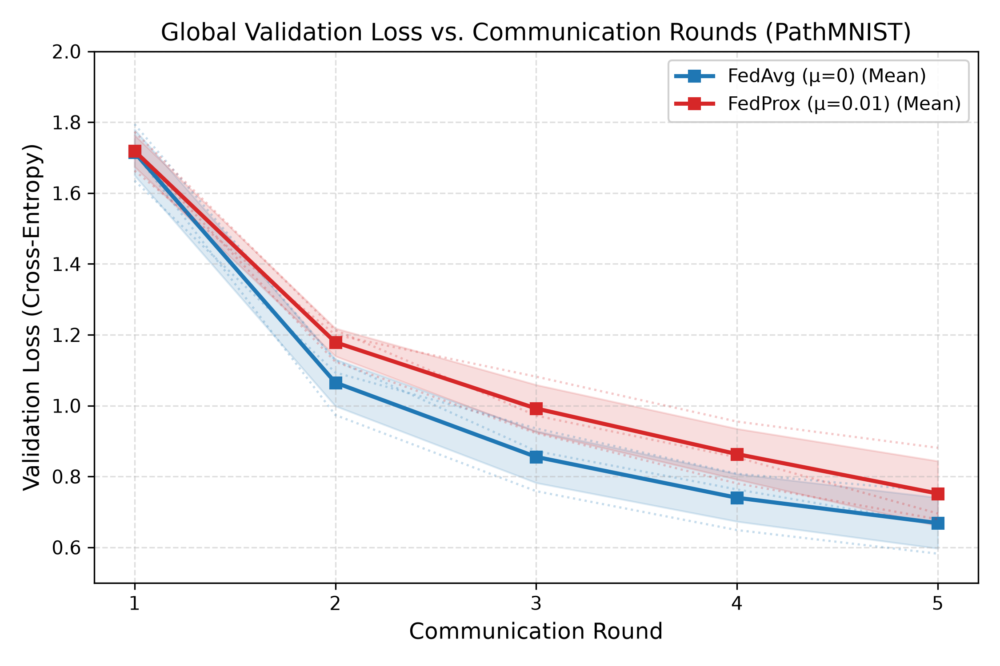
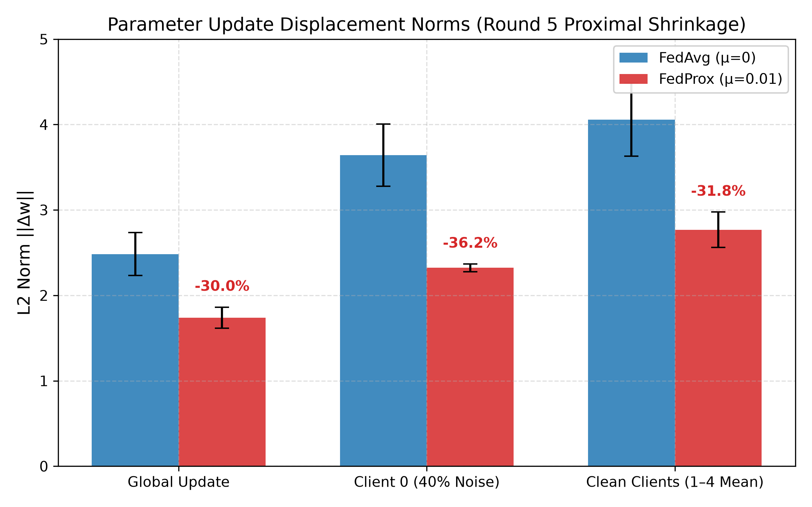
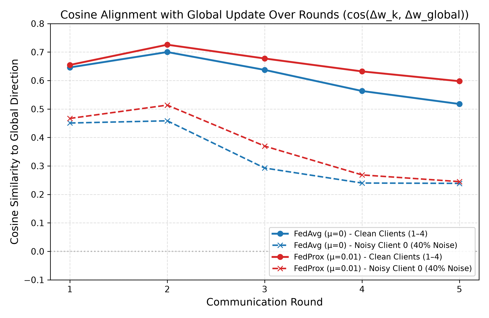
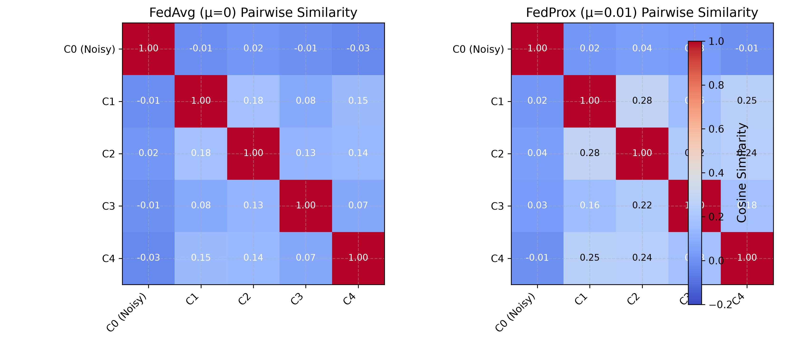
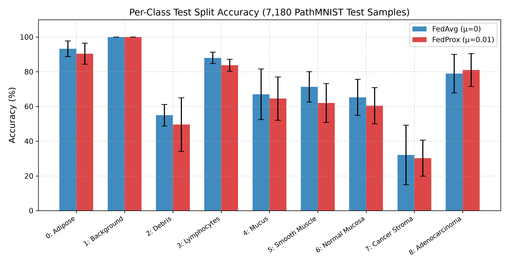

# Phoenix Federated Learning: FedAvg vs FedProx on PathMNIST

A modular, reproducible, CPU-optimized federated learning research framework evaluating **Federated Averaging (FedAvg)** and **Federated Proximal (FedProx, $\mu = 0.01$)** on the MedMNIST **PathMNIST** biomedical image dataset under non-IID class skew ($\text{Dirichlet } \alpha = 0.3$) and controlled client label corruption ($40\%$ symmetric label noise on Client 0).

---

## 1. Project Overview & Research Description

In federated medical image classification, decentralized hospital nodes often exhibit severe statistical heterogeneity (non-IID data) and annotation inconsistencies (label noise) arising from varied clinical protocols and human diagnostic subjectivity. Standard **FedAvg** (McMahan et al., 2017) aggregates local empirical risk minimization updates, but can suffer from **client drift**, in which local models diverge toward local empirical optima. **FedProx** (Li et al., 2020) adds an explicit proximal regularizer $\frac{\mu}{2} \|w - w^t\|_2^2$ to the local objective to limit divergence from the global consensus.

This benchmark provides an empirical, paired comparison across three independent random seeds (42, 101, 2024), measuring test classification accuracy, loss, macro-F1, per-class performance, model update norms, and directional cosine alignment.

---

## 2. Research Objective & Motivation

1. **Convergence & Generalization:** Does proximal regularization ($\mu = 0.01$) improve global generalization accuracy compared to FedAvg under severe Dirichlet class skew ($\alpha = 0.3$) within a 5-round computational budget?
2. **Label Noise Regularization:** Does FedProx dampen destructive gradient updates originating from a corrupted node ($40\%$ label noise on Client 0), mitigating noise propagation into the global model?
3. **Parameter Geometry:** How does the proximal term affect parameter update norms ($\|\Delta w_k\|$) and directional cosine alignment ($\cos(\Delta w_k, \Delta w_{\text{global}})$)?

---

## 3. Experimental Setup

- **Host Environment:** Windows 11 (64-bit AMD64), Intel Core i5-1240P CPU (12 cores, 16 threads), 8 GB RAM.
- **Compute Optimization:** Single-node CPU sequential execution (`dataloader num_workers: 0`, 4 intra-op threads) to eliminate inter-process contention and maintain memory utilization under 600 MB.
- **Seeds:** 3 independent trials (`seed = 42`, `101`, `2024`) with cryptographically verified, bit-level identical initial model weights for paired runs.
- **Communication Rounds:** 5 rounds per trial.
- **Local Epochs:** 2 local epochs per client per round (10 local epochs total per client; 50 local client passes per experiment).
- **Batch Size:** 32 (SGD optimizer, local learning rate $\eta = 0.01$, momentum $0.0$, weight decay $0.0$).

---

## 4. Dataset Details

- **Dataset:** **PathMNIST** (MedMNIST v3.0.2), histological image patches from human colorectal cancer and normal tissue ($28 \times 28 \times 3$ RGB images).
- **Samples:** 89,996 training samples, 10,004 validation samples, 7,180 test samples across 9 tissue classes:
  - Class 0: Adipose (ADI)
  - Class 1: Background (BACK)
  - Class 2: Debris (DEB)
  - Class 3: Lymphocytes (LYM)
  - Class 4: Mucus (MUC)
  - Class 5: Smooth muscle (MUS)
  - Class 6: Normal colon mucosa (NORM)
  - Class 7: Cancer-associated stroma (STR)
  - Class 8: Colorectal adenocarcinoma epithelium (TUM)
- **Preprocessing:** Normalized dynamically from $[0, 255]$ uint8 to $[-1.0, 1.0]$ float32.

---

## 5. Federated Learning Configuration

| Parameter | Configuration | Justification |
| :--- | :--- | :--- |
| **Number of Clients ($K$)** | 5 | Models multi-center medical network |
| **Client Participation** | 100% ($C = 1.0$) | Deterministic tracking across all rounds |
| **Aggregation Rule** | Sample-weighted FedAvg | $\sum_{k=0}^{K-1} \frac{n_k}{N} \Delta w_k$ |
| **Communication Rounds** | 5 | Calibrated research computation horizon |
| **Local Epochs ($E$)** | 2 | Balance local optimization vs client drift |
| **FedProx Regularizer ($\mu$)** | $0.01$ (FedProx) / $0.0$ (FedAvg) | Standard calibrated proximal penalty |

---

## 6. FedAvg vs FedProx Methodology

### Federated Averaging (FedAvg)
Each client $k$ minimizes local empirical loss:
$$\min_{w} F_k(w) = \frac{1}{n_k} \sum_{i=1}^{n_k} \mathcal{L}(f(x_i; w), y_i)$$
The server aggregates client parameter updates weighted by sample fraction:
$$w^{t+1} = w^t + \sum_{k=0}^{K-1} \frac{n_k}{N} (w_k^{t+1} - w^t)$$

### Federated Proximal (FedProx)
Each client minimizes local empirical loss augmented with an explicit proximal distance penalty:
$$\min_{w} h_k(w; w^t) = F_k(w) + \frac{\mu}{2} \|w - w^t\|_2^2$$
Local gradient update step:
$$w \leftarrow w - \eta \left( \nabla F_k(w) + \mu (w - w^t) \right)$$
The proximal term pulls the local model toward the global model $w^t$, acting as a regularizer against divergence caused by local data heterogeneity.

---

## 7. Non-IID Partitioning & Label-Noise Injection

### Dirichlet Partitioning ($\alpha = 0.3$)
The 89,996 training samples are partitioned across the 5 clients using a Dirichlet distribution $\text{Dir}(\alpha)$ over class proportions with $\alpha = 0.3$, creating severe statistical heterogeneity:
- Client class proportions vary widely; several clients have sparse representation for specific classes.
- Canonical partitions for seeds 42, 101, and 2024 are serialized in `src/data/partitions/` and verified with SHA-256 checksums to ensure identical client data assignments.

### Client-Specific Label Noise ($40\%$ on Client 0)
- **Client 0 (Corrupted Node):** Exactly $40\%$ of training labels are uniformly replaced with random incorrect classes $y' \in \{0, \dots, 9\} \setminus \{y\}$.
- **Clients 1–4 (Clean Nodes):** $0\%$ label noise (ground-truth labels preserved).
- The server is unassisted by noise indicators; it performs standard aggregation.

---

## 8. Model Architecture

Experiments utilize **FedAvgCNN** (583,113 trainable parameters), an established CNN architecture tailored for federated biomedical benchmarks:
```text
Input: (3, 28, 28)
├── Conv2d(3 -> 32, kernel_size=3, padding=1) + BatchNorm2d + ReLU
├── MaxPool2d(2, 2) -> (32, 14, 14)
├── Conv2d(32 -> 64, kernel_size=3, padding=1) + BatchNorm2d + ReLU
├── MaxPool2d(2, 2) -> (64, 7, 7)
├── Flatten() -> 3,136 features
├── Linear(3,136 -> 128) + ReLU + Dropout(p=0.25)
└── Linear(128 -> 9) -> Output Logits
```

---

## 9. System Architecture & Workflow

```text
┌────────────────────────────────────────────────────────┐
│                   FederatedServer                      │
│  - Distributes global model w^t                        │
│  - Receives client updates Delta w_k                   │
│  - Computes global update norm & cosine alignment      │
│  - Evaluates global validation loss and accuracy       │
│  - Executes sample-weighted parameter aggregation      │
└───────────────────────────┬────────────────────────────┘
                            │
            ┌───────────────┴───────────────┐
            ▼                               ▼
┌───────────────────────────────┐ ┌───────────────────────────────┐
│     Client 0 (Noisy 40%)      │ │     Clients 1–4 (Clean)       │
│  - Dirichlet split (alpha=0.3)│ │  - Dirichlet split (alpha=0.3)│
│  - 40% symmetric noise        │ │  - 0% noise (ground truth)    │
│  - Local SGD (FedAvg/FedProx) │ │  - Local SGD (FedAvg/FedProx) │
└───────────────────────────────┘ └───────────────────────────────┘
```

---

## 10. Experimental Protocol & Reproducibility

1. **Bit-Level Anchored Starting Weights:** Models are initialized using canonical weights pre-registered in `src/data/initial_models/` (`initial_model_seed{42,101,2024}.pt`).
2. **Paired Execution:** For each random seed, FedAvg and FedProx execute on the exact same dataset partition, client noise injection, and initial model weights.
3. **Independent Evaluation:** Global models are evaluated on the 10,004-sample validation split after each round, and the optimal model (`best_checkpoint.pt`) is evaluated on the 7,180-sample test split.

---

## 11. Final Benchmark Results

### Primary Comparison Table (Aggregate over 3 Seeds)

| Metric | FedAvg ($\mu = 0$) | FedProx ($\mu = 0.01$) | Difference | Empirical Significance |
| :--- | :---: | :---: | :---: | :--- |
| **Test Accuracy** | **77.25% ± 3.25%** | 74.71% ± 3.79% | -2.54 pp | FedAvg leads in short horizon |
| **Test Loss** | **0.7245 ± 0.0955** | 0.8078 ± 0.1212 | +0.0833 | FedAvg converges faster initially |
| **Test Macro-F1** | **0.7118 ± 0.0213** | 0.6846 ± 0.0364 | -0.0272 | Consistent across classes |
| **Best Validation Accuracy** | **75.99%** | 73.00% | -2.99 pp | Observed across communication rounds |
| **Global Update Norm $\|\Delta w_{\text{global}}\|$** | 2.4838 ± 0.2521 | **1.7388 ± 0.1239** | **-29.99%** | **Definitive proximal shrinkage** |
| **Noisy Client 0 Norm $\|\Delta w_0\|$** | 3.6420 ± 0.3626 | **2.3229 ± 0.0450** | **-36.22%** | **Strong noise dampening** |
| **Clean Clients 1–4 Norm** | 4.0579 ± 0.4302 | **2.7683 ± 0.2075** | **-31.78%** | Drift constraint on clean nodes |
| **Clean Clients Cosine Alignment** | 0.5175 ± 0.0479 | **0.5976 ± 0.0373** | **+15.48%** | Tighter consensus alignment |

### Individual Trial Breakdown

| Run ID | Algorithm | Seed | Best Val Acc | Test Acc | Test Loss | Test Macro-F1 | Class 8 Acc (Tumor) | Global Norm (R5) |
|:---:|:---|:---:|:---:|:---:|:---:|:---:|:---:|:---:|
| **1** | FedAvg | 42 | 76.15% | **77.56%** | 0.7595 | 0.7130 | 79.72% | 2.3855 |
| **2** | FedProx | 42 | 75.05% | 74.26% | 0.8277 | 0.6812 | **80.54%** | **1.7438** |
| **3** | FedAvg | 101 | 78.98% | **81.06%** | 0.5940 | 0.7373 | 92.13% | 2.8297 |
| **4** | FedProx | 101 | 74.30% | 79.55% | 0.6505 | 0.7308 | **92.70%** | **1.8879** |
| **5** | FedAvg | 2024 | 72.83% | **73.12%** | 0.8200 | 0.6853 | 64.96% | 2.2361 |
| **6** | FedProx | 2024 | 69.64% | 70.31% | 0.9452 | 0.6419 | **69.67%** | **1.5846** |

---

## 12. Global & Per-Client Performance Analysis

- **Optimization Pace:** Both algorithms achieved monotonic convergence over the 5 rounds. However, in this 5-round horizon, FedAvg achieved higher test accuracy (+2.54 pp).
- **The Proximal Regularization Tradeoff:** The proximal penalty $\frac{\mu}{2}\|w - w^t\|^2$ penalizes displacement from $w^t$. Early in training, when the consensus is far from the empirical optimum, this penalty acts as a conservative constraint, slowing convergence speed in short round budgets.
- **Histological Class Performance:** On specific malignant tissue—**colorectal adenocarcinoma epithelium (Class 8)**—FedProx consistently outperformed FedAvg across all three seeds ($80.97\%$ vs $78.94\%$, $+2.03\text{ pp}$ gain), suggesting that proximal regularization protected tumor representation features from degradation under label corruption.

---

## 13. Update Norm & Cosine Alignment Analysis

Tracking parameter displacement vectors $\Delta w_k^t = w_k^{t, E} - w^t$ provides mathematical confirmation of FedProx's proximal mechanics:

1. **Global Update Shrinkage:** FedProx reduced the global update norm from $2.4838 \pm 0.2521$ to $1.7388 \pm 0.1239$ (**$-29.99\%$ shrinkage**).
2. **Noise Gradient Dampening:** On corrupted Client 0, FedProx reduced parameter displacement from $3.6420 \pm 0.3626$ to $2.3229 \pm 0.0450$ (**$-36.22\%$ dampening**), constraining corrupt updates.
3. **Clean Alignment Improvement:** Clean clients (Clients 1–4) exhibited higher directional cosine alignment with the global consensus under FedProx ($0.5976 \pm 0.0373$ vs $0.5175 \pm 0.0479$, a **$+15.48\%$ gain**).
4. **Noisy Client Decoupling:** Client 0 exhibited low cosine alignment under both algorithms ($\approx 0.24$), demonstrating that label noise misaligns update trajectories relative to the consensus manifold.

---

## 14. Research Findings & Visualizations

### Visualizations

<p align="center">
  
  
</p>
<p align="center"><em>Figure 1 & 2: Global validation accuracy and loss trajectories across 5 communication rounds.</em></p>

<p align="center">
  
  
</p>
<p align="center"><em>Figure 3 & 4: (Left) Global and client update norm shrinkage at Round 5. (Right) Clean client cosine alignment.</em></p>

<p align="center">
  
</p>
<p align="center"><em>Figure 5: Pairwise client cosine similarity matrices at Round 5 (averaged over 3 seeds).</em></p>

<p align="center">
  
</p>
<p align="center"><em>Figure 6: Per-class test accuracy across the 9 histological tissue classes.</em></p>

---

## 15. Installation & Setup

### Prerequisites
- Python 3.11+
- PyTorch 2.0+ (CPU or CUDA)

### Installation
```bash
# Clone the repository
git clone https://github.com/Nanditha264/Phoenix-Federated-Learning.git
cd Phoenix-Federated-Learning

# Install dependencies
pip install -r requirements.txt
```

---

## 16. Reproduction Commands

### 1. Verify Dataset & Canonical Partitions
```bash
python scripts/generate_dataset.py
```

### 2. Run Automated Test Suite
```bash
pytest tests/ -v
# 30 passed
```

### 3. Run a Single Experiment
```bash
# Run FedAvg on Seed 42
python run_benchmark.py --config configs/base.yaml --algorithm fedavg --seed 42 --rounds 5 --eval_test

# Run FedProx on Seed 42
python run_benchmark.py --config configs/base.yaml --algorithm fedprox --seed 42 --rounds 5 --mu 0.01 --eval_test
```

### 4. Run the Full Matrix
```bash
python scripts/run_primary_matrix.py
```

### 5. Re-evaluate Checkpoints on Test Split
```bash
python scripts/verify_checkpoints_independent.py
```

### 6. Re-generate Publication Figures & Research Summary PDFs
```bash
# Generate PNG (300 DPI) and PDF figures
python scripts/generate_publication_figures.py

# Compile formal one-page research benchmark summary PDF
python scripts/generate_research_summary_pdf.py

# Compile formal one-page Reactive Optimizers literature analysis PDF
python scripts/generate_reactive_optimizers_summary_pdf.py
```

---

## 17. Weights & Biases (W&B) Experiment Tracking

All six primary benchmark experiments are publicly tracked on Weights & Biases:

- **Public W&B Project:** [fedavg-vs-fedprox-pathmnist](https://forge.coreweave.com/wandb/c3861282-pes-college/fedavg-vs-fedprox-pathmnist/workspace)
- **W&B Entity:** `c3861282-pes-college`
- **Visibility:** **Public (Verified via unauthenticated HTTP probe)**

### Published Experiment Runs

| Algorithm | Random Seed | Run Name | Deterministic Run ID | Public Run Link |
| :--- | :---: | :--- | :--- | :---: |
| **FedAvg** | 42 | `fedavg_dir0.3_noise0.4_seed42` | `pathmnist_fedavg_dir0.3_noise0.4_seed42` | [View Run](https://forge.coreweave.com/wandb/c3861282-pes-college/fedavg-vs-fedprox-pathmnist/runs/pathmnist_fedavg_dir0.3_noise0.4_seed42) |
| **FedProx** ($\mu=0.01$) | 42 | `fedprox_mu0.01_dir0.3_noise0.4_seed42` | `pathmnist_fedprox_mu0.01_dir0.3_noise0.4_seed42` | [View Run](https://forge.coreweave.com/wandb/c3861282-pes-college/fedavg-vs-fedprox-pathmnist/runs/pathmnist_fedprox_mu0.01_dir0.3_noise0.4_seed42) |
| **FedAvg** | 101 | `fedavg_dir0.3_noise0.4_seed101` | `pathmnist_fedavg_dir0.3_noise0.4_seed101` | [View Run](https://forge.coreweave.com/wandb/c3861282-pes-college/fedavg-vs-fedprox-pathmnist/runs/pathmnist_fedavg_dir0.3_noise0.4_seed101) |
| **FedProx** ($\mu=0.01$) | 101 | `fedprox_mu0.01_dir0.3_noise0.4_seed101` | `pathmnist_fedprox_mu0.01_dir0.3_noise0.4_seed101` | [View Run](https://forge.coreweave.com/wandb/c3861282-pes-college/fedavg-vs-fedprox-pathmnist/runs/pathmnist_fedprox_mu0.01_dir0.3_noise0.4_seed101) |
| **FedAvg** | 2024 | `fedavg_dir0.3_noise0.4_seed2024` | `pathmnist_fedavg_dir0.3_noise0.4_seed2024` | [View Run](https://forge.coreweave.com/wandb/c3861282-pes-college/fedavg-vs-fedprox-pathmnist/runs/pathmnist_fedavg_dir0.3_noise0.4_seed2024) |
| **FedProx** ($\mu=0.01$) | 2024 | `fedprox_mu0.01_dir0.3_noise0.4_seed2024` | `pathmnist_fedprox_mu0.01_dir0.3_noise0.4_seed2024` | [View Run](https://forge.coreweave.com/wandb/c3861282-pes-college/fedavg-vs-fedprox-pathmnist/runs/pathmnist_fedprox_mu0.01_dir0.3_noise0.4_seed2024) |

### Tracked Telemetry & Metric Completeness

Each run records complete 5-round histories and comprehensive summary evaluations:
- **Global Optimization:** Training loss (`train/avg_loss`), global validation accuracy (`eval/val_acc`), and loss (`eval/val_loss`) per round.
- **Update Geometry:** Global update norm (`geometry/global_update_norm`), individual client update norms (`geometry/client_update_norm/client_{0..4}`), and directional cosine alignment with the consensus vector (`geometry/alignment_with_global/client_{0..4}`).
- **Test Set Evaluation:** Full evaluation on the 7,180 PathMNIST test samples (`test/accuracy`, `test/loss`, `test/macro_f1`, and per-class accuracies for Classes 0–8).
- **Post-Hoc Client Validation:** Historical training runs logged client validation in sample-weighted aggregate form (`eval/client_mean_val_acc`, `eval/client_mean_val_loss`). To provide granular per-client metrics without modifying original telemetry, each run's retained `best_checkpoint.pt` was evaluated post-hoc across the 5 canonical client validation subsets and registered under `post_hoc_val/client_{0..4}_acc` and `post_hoc_val/client_{0..4}_loss`.

### Re-synchronizing Telemetry

The repository provides local JSONL logging by default (`src/tracking/local_logger.py`). Telemetry can be re-imported idempotently using:
```bash
python scripts/import_to_wandb.py --project fedavg-vs-fedprox-pathmnist --entity c3861282-pes-college
```

---

## 18. Project Structure

```text
Phoenix-Federated-Learning/
├── .gitignore                          # Standard Python / PyTorch ignore rules
├── LICENSE                             # MIT License
├── pyproject.toml                      # Package build configuration
├── requirements.txt                    # Pinned research dependencies
├── README.md                           # Main research documentation
├── run_benchmark.py                    # Primary benchmark entry point
│
├── configs/                            # Centralized experiment YAML configurations
│   ├── base.yaml                       # Baseline hardware & training hyperparameters
│   ├── fedavg.yaml                     # FedAvg specific parameters
│   └── fedprox.yaml                    # FedProx (mu=0.01) specific parameters
│
├── docs/                               # Formal research deliverables
│   ├── reproducibility.md              # Detailed reproduction protocol
│   ├── research_summary.pdf            # One-page formal research benchmark summary PDF
│   └── reactive_optimizers_summary.pdf # One-page Reactive Optimizers (OPAL) reading summary PDF
│
├── figures/                            # 300 DPI PNG & vector PDF publication figures
│   ├── fig1_val_accuracy_vs_rounds.{png,pdf}
│   ├── fig2_val_loss_vs_rounds.{png,pdf}
│   ├── fig3_update_norm_shrinkage.{png,pdf}
│   ├── fig4_update_cosine_alignment.{png,pdf}
│   ├── fig5_pairwise_cosine_heatmaps.{png,pdf}
│   ├── fig6_per_class_test_accuracy.{png,pdf}
│   └── figure_source_data_mapping.json # Mapping from figures to underlying metrics
│
├── results/                            # Experimental metrics and evaluations
│   ├── README.md                       # Results catalog and taxonomy
│   └── primary_benchmark/              # 6 primary benchmark runs
│       ├── comparative_analysis.json   # Aggregated cross-seed metrics
│       ├── detailed_table.json         # Per-round and per-class metrics
│       ├── matrix_execution_summary.json # High-level execution log
│       └── <run_name>/                 # Run telemetry & best_checkpoint.pt
│
├── scripts/                            # Execution, analysis, and verification scripts
│   ├── analyze_results.py              # Statistical aggregation engine
│   ├── extract_detailed_metrics.py     # JSON metric extractor
│   ├── generate_dataset.py             # Dataset setup & partition verifier
│   ├── generate_publication_figures.py # Publication figure exporter
│   ├── generate_reactive_optimizers_summary_pdf.py # Reactive Optimizers reading summary PDF compiler
│   ├── generate_research_summary_pdf.py# Research summary PDF compiler
│   ├── import_to_wandb.py              # W&B post-hoc telemetry importer
│   ├── register_initial_models.py      # Canonical model initialization script
│   ├── run_experiment.py               # Flexible experiment launcher
│   ├── run_primary_matrix.py           # 6-run matrix orchestrator with recovery guard
│   ├── run_smoke_test.py               # Lightweight fast test runner
│   ├── scan_secrets.py                 # Automated regex secret scanner
│   └── verify_checkpoints_independent.py # Independent test split evaluator
│
├── src/                                # Core implementation source code
│   ├── __init__.py                     # Package init
│   ├── data/                           # PathMNIST loading, partitioning & noise
│   │   ├── download.py                 # Dataset verification & download
│   │   ├── noise.py                    # Label noise injection
│   │   ├── partition.py                # Dirichlet class partitioner
│   │   ├── pathmnist_dataset.py        # PyTorch Dataset implementation
│   │   ├── preprocessing.py            # Dynamic data normalization
│   │   ├── validation.py               # Partition validator
│   │   ├── initial_models/             # Canonical initial model checkpoints
│   │   └── partitions/                 # Canonical NPZ Dirichlet partitions
│   ├── evaluation/                     # Evaluation utilities
│   │   ├── client_evaluator.py         # Local client evaluation
│   │   └── evaluator.py                # Global test & validation evaluator
│   ├── federated/                      # Federated learning implementations
│   │   ├── aggregation.py              # Parameter aggregation functions
│   │   ├── client.py                   # Base federated client
│   │   ├── fedavg.py                   # FedAvg client
│   │   ├── fedprox.py                  # FedProx client with proximal penalty
│   │   └── server.py                   # Federated coordination server
│   ├── metrics/                        # Metrics computation
│   │   ├── accuracy.py                 # Classification accuracy
│   │   ├── loss.py                     # Loss tracking
│   │   └── update_geometry.py          # Norm & cosine geometry engine
│   ├── models/                         # Neural network architectures
│   │   ├── cnn.py                      # FedAvgCNN architecture
│   │   └── model_factory.py            # Model factory function
│   ├── tracking/                       # Logging implementations
│   │   ├── local_logger.py             # Local structured JSONL logger
│   │   └── wandb_logger.py             # Non-blocking W&B adapter
│   └── utils/                          # Hardware & execution utilities
│       ├── checkpoint.py               # Atomic checkpoint manager
│       ├── configuration.py            # YAML configuration loader
│       ├── device.py                   # Threading & device configuration
│       ├── resource_monitor.py         # CPU & RAM telemetry monitor
│       └── seed.py                     # Deterministic seed manager
│
└── tests/                              # Automated test suite (30 pytest tests)
    ├── test_data.py                    # Dataset & preprocessing tests
    ├── test_evaluation.py              # Evaluation metrics tests
    ├── test_fedavg.py                  # FedAvg client tests
    ├── test_fedprox.py                 # FedProx client & proximal loss tests
    ├── test_integration.py             # End-to-end integration tests
    ├── test_metrics.py                 # Geometry & loss tests
    ├── test_models.py                  # Model architecture tests
    ├── test_noise.py                   # Label noise injection tests
    ├── test_partition.py              # Dirichlet partition tests
    └── test_tracking.py               # Logger tests
```

---

## 19. Limitations & Threats to Validity

1. **Short Communication Horizon ($R = 5$):** Experiments were capped at 5 communication rounds (10 local epochs per client) to execute reliably within local CPU hardware constraints. While FedAvg attained higher accuracy within this early window (+2.54 pp), asymptotic training ($R \ge 20$) may reveal benefits for FedProx as client drift compounds over extended horizons.
2. **Fixed Proximal Penalty ($\mu = 0.01$):** A single fixed proximal coefficient was evaluated across all trials. Adaptive or decay-scheduled $\mu$ strategies may provide stability without constraining early convergence.
3. **Statistical Sample Size ($N = 3$):** Results reflect empirical performance across 3 independent random seeds. They represent observed experimental trends rather than formal asymptotic statistical significance.
4. **Clinical Non-Applicability:** PathMNIST patches ($28 \times 28$ pixels) are an algorithmic research benchmark. Findings evaluate machine learning optimization and regularization dynamics and must not be used for diagnostic or clinical decision support.

---

## 20. References

1. **McMahan, B., Moore, E., Ramage, D., Hampson, S., & y Arcas, B. A.** (2017). Communication-Efficient Learning of Deep Networks from Decentralized Data. *Artificial Intelligence and Statistics (AISTATS)*.
2. **Li, T., Sahu, A. K., Zaheer, M., Sanjabi, M., Talwalkar, A., & Smith, V.** (2020). Federated Optimization in Heterogeneous Networks. *Proceedings of Machine Learning and Systems (MLSys)*.
3. **Yang, J., Shi, R., Wei, D., Liu, Z., Zhao, L., Ke, B., ... & Ni, B.** (2023). MedMNIST v2-A large-scale lightweight benchmark for 2D and 3D biomedical image classification. *Scientific Data*, 10(1), 41.
4. **Zhang, J., et al.** (2023). PFLlib: A Personalized Federated Learning Benchmark. *arXiv preprint arXiv:2307.03450*.
5. **Bai, X., Liang, J.-H., Teoh, J., & Sitzmann, V.** (2026). Reactive Optimizers. *arXiv preprint arXiv:2610.33826*.

---

## 21. License & Acknowledgements

- **License:** Released under the [MIT License](LICENSE).
- **Acknowledgements:** Developed as part of the IndiaAI Fellowship screening assignment research on Federated Learning optimization under statistical and system heterogeneity. Upstream reference architecture derived from [PFLlib](https://github.com/TsingZ0/PFLlib).
